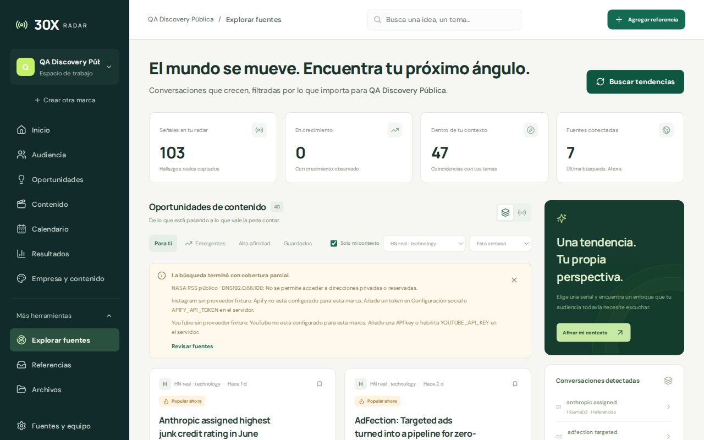
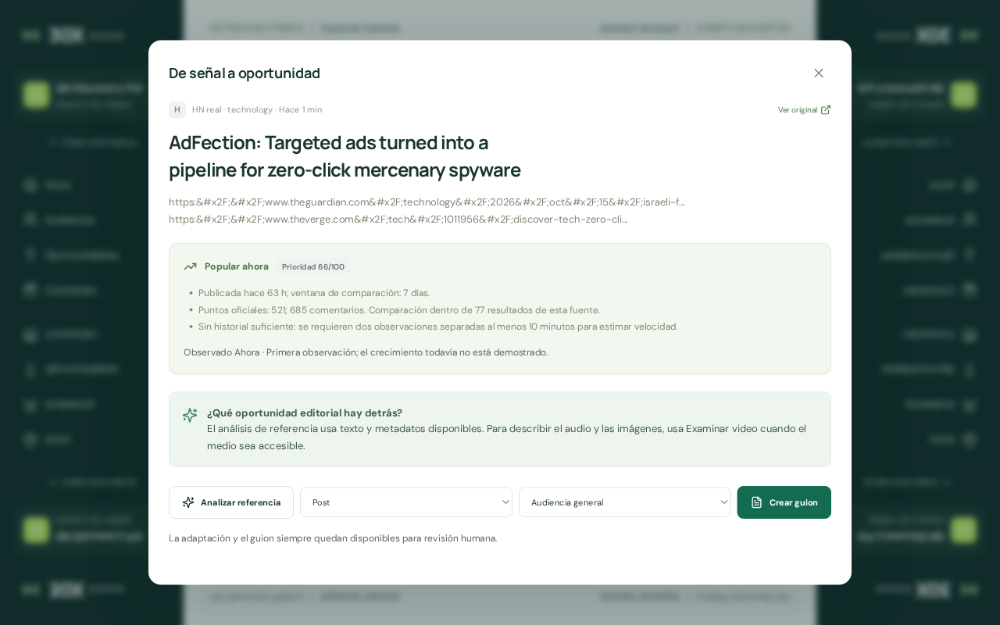
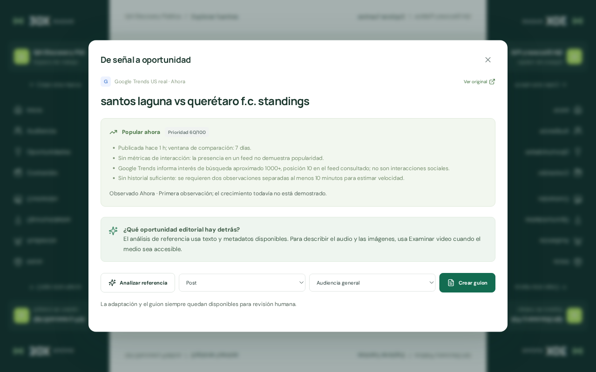
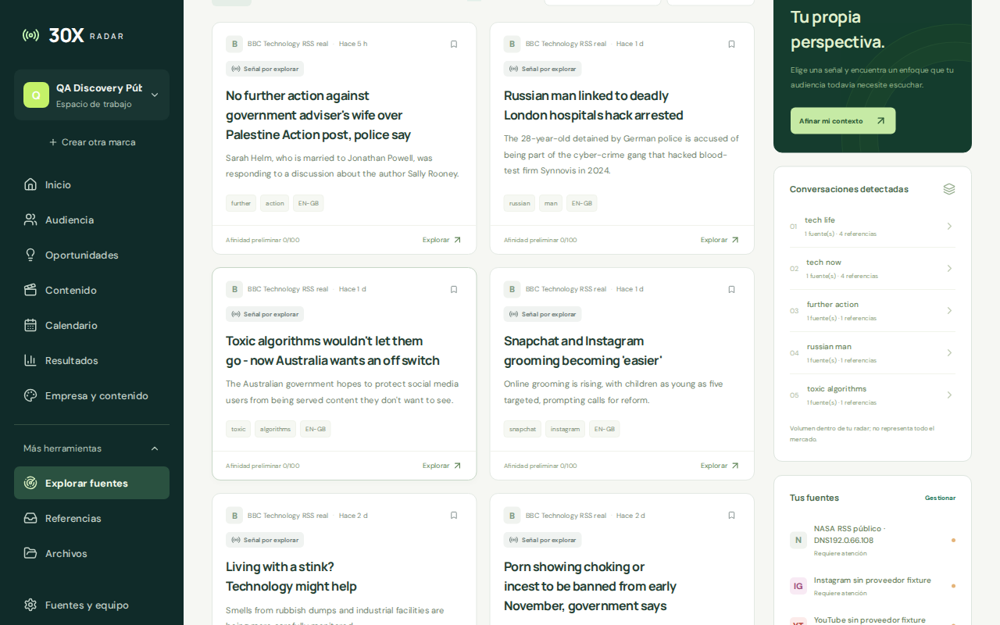

**Auditoría independiente de descubrimiento público — discovery**

**Resultado: FAIL.** 14 casos: 11 PASS, 2 FAIL y 1 BLOCKED. Dos hallazgos confirmados: un P2 y un P3. Se obtuvieron 103 referencias públicas reales mediante la UI, sin credenciales ni pago. No se corrigió código de la aplicación.

Entorno: build existente en `http://127.0.0.17:4107/radar`, proceso propio PID 3844929 / sesión 73773, base `/tmp/30x-adversarial-discovery/radar.sqlite`, empresa `9da2822f-e2f6-4747-8916-7bca4e46aff4`. Cuenta ficticia `qa-discovery@example.com`. Descubrimiento periódico desactivado según BRIEF. Sólo se operó la pestaña `tab_3s_07e54779-9ab2-4979-8a15-674c4eff160a`; pestaña y proceso cerrados al concluir, datos preservados.

La cuenta, empresa y contexto son fixtures sintéticas preparadas por API. Se reemplazaron las fuentes iniciales por HN/technology, BBC Technology RSS y Google Trends US, un RSS deliberadamente roto y YouTube/Instagram sin proveedor. El contenido descubierto provino de respuestas públicas reales. CRUD de fuentes y captura manual quedan fuera de este informe.

**Hallazgos confirmados**

**discovery-1 · P2 · El clasificador bloquea el RSS público de NASA al tratar 192.0/16 como reservado**

Reproducción:

1. Crear una fuente RSS habilitada con URL https://www.nasa.gov/feed/ (fixture por API en la base propia).
2. En /radar pulsar Buscar tendencias.
3. Comparar el error de NASA con GET externo HTTP 200 y resolución DNS 192.0.66.108.

Esperado: La dirección 192.0.66.108 no pertenece al bloque especial 192.0.0.0/24 y el RSS público accesible debe consultarse.

Observado: UI/API: «No se permite acceder a direcciones privadas o reservadas.» NASA aporta 0 referencias aunque su RSS devuelve 10 entradas. isPublicAddress retorna false porque server/connectors.mjs:34 rechaza cualquier 192.0.x.x. Es un fallo de la aplicación, no bloqueo externo.

Causa apoyada por código: `server/connectors.mjs:34`, `server/connectors.mjs:100`, `server/intelligence.mjs:656`.

La clasificación local rechaza todo `192.0/16`; el bloque de asignaciones especiales relevante de IANA es `192.0.0.0/24`. La dirección pública observada de NASA queda fuera de ese bloque. [Registro primario de IANA](https://www.iana.org/assignments/iana-ipv4-special-registry/). La prueba principal es UI + respuesta `/discover` + DNS + GET externo HTTP 200 con un RSS de 10 entradas, repetida en la misma base. Se diferencia así de un bloqueo del proveedor.

**discovery-2 · P3 · Hacker News deja entidades HTML hexadecimales visibles en las referencias**

Reproducción:

1. Descubrir desde una fuente Hacker News con query technology.
2. Buscar AdFection y pulsar Explorar.
3. Comparar tarjeta/detalle con https://news.ycombinator.com/item?id=50101813.

Esperado: Mostrar https://... y apóstrofes como texto legible, manteniendo el saneamiento HTML.

Observado: Texto visible y persistido contiene `&#x2F;` y otros textos contienen `&#x27;`. La limpieza sólo decodifica unas pocas entidades; el enlace Ver original funciona. La evidencia sigue disponible pero pierde legibilidad.

Causa apoyada por código: `server/intelligence.mjs:40`, `server/intelligence.mjs:617`, `src/features/Discovery.tsx:799`, `src/features/Discovery.tsx:1091`.

La página pública HN y la API original se contrastaron con el estado de Radar: título AdFection, enlace Citizen Lab, 521 puntos y 685 comentarios coinciden. La falla afecta al texto legible, no al enlace principal.

**Casos contrastados**

| Caso | Esperado | Observado | Resultado |
| --- | --- | --- | --- |
| Radar vacío de una empresa nueva | Cero referencias reales, sin ejemplos presentados como evidencia; acción para explorar. | UI muestra 0 señales, 0 emergentes, 0 oportunidades y «Explorar mis fuentes»; estado vacío confirmado. | PASS |
| Sincronización real RSS/HN/Google Trends desde UI | Obtener hallazgos públicos reales de las fuentes disponibles con procedencia, sin claves. | Buscar tendencias devolvió 103 altas y 5 actualizaciones: HN 77 candidatos/72 altas; BBC 21; Trends 10. API/SQLite y métrica UI contienen 103 referencias no demo. | PASS |
| Exactitud de título, URL y métricas frente al origen público | Los títulos y enlaces deben existir públicamente; las métricas deben corresponder a su fuente. | BBC: título AI giant Anthropic woos potential investors ahead of stock market debut coincide con H1 público sin login. HN AdFection: mismo título, URL Citizen Lab, 521 puntos y 685 comentarios en página pública y UI. Las 10 consultas/traffic Trends coinciden con RSS público. | PASS |
| Repetición y deduplicación | Repetir no crea copias del mismo corpus; conserva referencias. | Segunda búsqueda: 0 altas / 108 operaciones de actualización y 103 referencias. Los 103 IDs de la segunda búsqueda permanecen idénticos tras posteriores sincronizaciones y recarga. | PASS |
| Error parcial HTTP 404 | El RSS deliberadamente roto debe mostrar su error sin descartar los éxitos. | Banner de cobertura parcial muestra HTTP 404 y dos proveedores ausentes; las 103 referencias exitosas se conservan. lastError/lastAttemptAt por fuente coinciden con API. | PASS |
| Gates sociales sin proveedor | No fabricar resultados ni llamar a proveedores de pago; explicar configuración pendiente y recuperación. | YouTube y Apify/Instagram producen 0 altas con error específico que pide API key/token y remite a configuración. Se mantienen independientes de fuentes abiertas. | PASS |
| Filtros de fuente, periodo, búsqueda y afinidad | Cantidades y tarjetas deben respetar la selección y el estado persistido. | BBC con Solo mi contexto desactivado: 24 h=1, semana=14, historial=21. Buscar Anthropic reduce BBC/semana a 1. Alta afinidad, todas las fuentes y contexto activo muestra 6, igual al estado. El total global 103 permanece distinguible de los 45 resultados por defecto. | PASS |
| Grupos temáticos y vista radar | Grupos y cantidades deben derivar del corpus filtrado e indicar límites de cobertura. | BBC/historial: Tech Life=4 y Tech Now=4, cada grupo 1 fuente principal. Pulsar Tech Life abre la referencia del grupo. Vista radar muestra burbujas y leyenda de tamaño/repetición dentro del corpus; no representa todo el mercado. | PASS |
| Semántica de Google Trends y ausencia de falso crecimiento | Interés de búsqueda no debe convertirse en interacción social o tendencia LinkedIn; sin línea base no demostrar crecimiento. | Detalle Trends distingue 1000+ de interés aproximado, puesto 10 y no interacciones sociales; Ver original abre una URL explore específica de la consulta/US. 0 emergentes después de las búsquedas rápidas y mensaje que pide observaciones separadas. No se atribuye crecimiento a LinkedIn. | PASS |
| Recuperación de fuente y deduplicación entre fuentes | Una fuente antes fallida debe limpiar lastError al funcionar y agregar evidencia sin duplicar referencias. | RSS roto→NASA tuvo el fallo discovery-1. Cambiado después a BBC accesible: 21 entradas consultadas, 0 altas, 21 actualizaciones, lastError eliminado y lastSyncedAt/lastResultCount=21. IDs y total103 retenidos; evidence guarda la segunda fuente configurada. | PASS |
| Decisión guardada y persistencia tras sincronizar/recargar | Guardar una referencia debe persistir, conservar su ID y sobrevivir a nueva búsqueda/recarga. | AdFection id302e8e7b-a2f7-4453-bab0-28165a03e15f guardada por UI; Guardados=1 antes/después de buscar y recargar, mismo ID/status saved; corpus 103. | PASS |
| NASA RSS público frente a clasificador de red | Consultar un RSS público accesible con DNS público; aplicar restricciones a rangos realmente privados/reservados. | GET externo a NASA=200, RSS 10 entradas, DNS 192.0.66.108. Buscar tendencias rechaza la fuente como privada/reservada y devuelve 0 altas. Reproducido dos veces desde UI/API; clasificador de app retorna false para IPv4 pública. | FAIL |
| Legibilidad de texto importado HN | El texto HTML público debe convertirse a texto legible, decodificando entidades ordinarias. | Tarjeta y detalle AdFection muestran literalmente `https:&#x2F;&#x2F;...`; página HN muestra https://... correctamente. También aparecen &#x27; en otros textos. El contenido persistido conserva la codificación. | FAIL |
| Integración real de proveedores sociales | Resultados reales de YouTube/Instagram sólo con acceso y credenciales válidas. | No hay credenciales de operador; no se configuraron ni consumieron proveedores de pago. Se verificaron únicamente los gates, no la integración real ni su calidad. | BLOCKED |

La primera consulta procesó 108 candidatos de fuentes abiertas y dejó 103 referencias únicas: 77 candidatos HN produjeron 72 altas y 5 actualizaciones por deduplicación dentro de esa consulta. Las consultas repetidas reportan operaciones de actualización (108 o 129 al añadir la fuente duplicada), no un nuevo total de referencias. Se comprobó por separado el total único y la igualdad de los 103 IDs.

La recuperación se comprobó convirtiendo el RSS roto en una segunda configuración del RSS BBC accesible: 21 resultados, cero copias nuevas, error limpio y evidencia de ambas fuentes. La fuente NASA quedó añadida por separado al final para preservar una reproducción del P2.

**Evidencias y límites**

- Auditoría manual de build existente, sin rebuild ni cambios en aplicación, y con DATA_DIR exclusivo. No se leyeron reportes ajenos.
- Cuenta, empresa, contexto, RSS roto y fuentes duplicadas son fixtures sintéticas creadas por API; los 103 contenidos y respuestas RSS/HN/Trends son reales y no demo.
- No se probaron credenciales, scraping de pago, publicación, IA, acceso tras login ni integración social real.
- DISCOVERY_ENABLED=false por contrato: no se evaluaron agenda periódica ni backoff del scheduler. Sí hubo reintentos manuales y recuperación de un error.
- Las búsquedas se realizaron en pocos minutos: se validó ausencia de crecimiento inventado con primera observación, no crecimiento real tras ventanas separadas 10 min.
- Una página BBC y una discusión HN se abrieron realmente en navegador; no se abrió cada uno de los 103 originales ni todos los relatedUrls de Trends.
- GDELT, Reddit y otras regiones Trends no formaron parte de esta muestra. Los fallos de credenciales están BLOCKED; NASA es FAIL observado con causa local corroborada.

Respuestas de sincronización, conteos, IDs, fuentes, filtros, procedencia y estado guardado: [discovery-observations.json](../evidence/discovery-observations.json). Comprobación externa mínima de NASA/HN/BBC/Trends: [discovery-public-checks.json](../evidence/discovery-public-checks.json). Cierre del entorno: [discovery-lifecycle.json](../evidence/discovery-lifecycle.json). Informe estructurado: [discovery.json](discovery.json).
