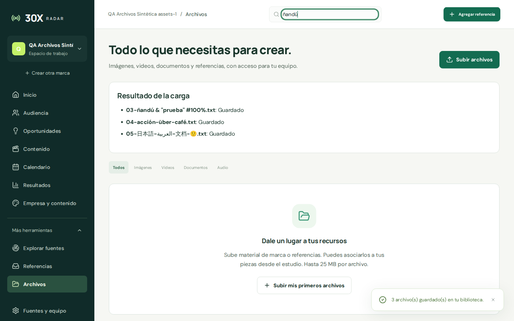
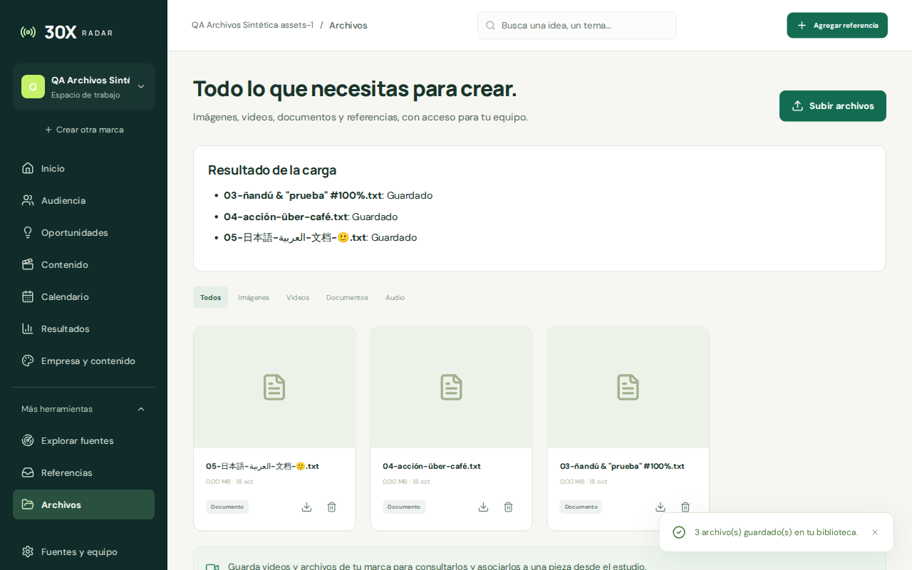
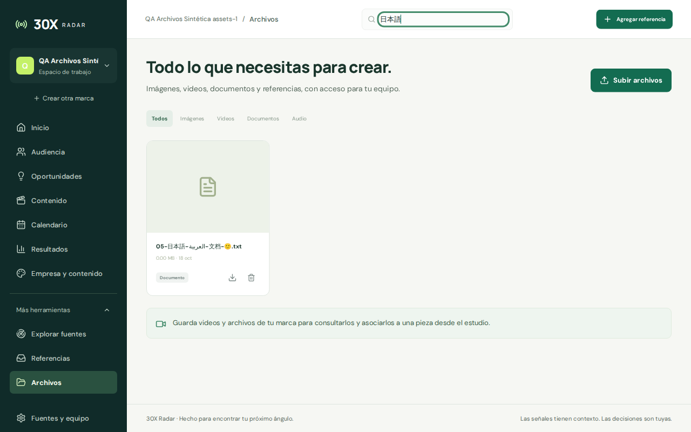

# assets-1 · Nombres Unicode en Archivos

Estado: **fixed**, pendiente de integración del coordinador. Datos sintéticos, instancia propia `127.0.1.25:5515`, API `4515`, `DATA_DIR=/tmp/30x-remediation-assets-1`.

La subida ya guarda el nombre original UTF-8. La biblioteca lo encuentra al buscarlo, el detalle lo conserva y la descarga devuelve el nombre correcto junto a los mismos bytes originales.

## Causa y corrección

Multer/Busboy usaba Latin-1 para `filename` sin charset, por lo que `ñandú` se convertía en `ñandú` antes de persistir. Biblioteca, búsqueda y descarga propagaban ese valor. El recorte anterior también podía perder la extensión y cortar un par surrogate al alcanzar 200 unidades UTF-16.

`server/upload-filenames.mjs` encapsula el `streamHandler` público de Multer 2.4.0. Compara el parser principal Latin-1 con una lectura de metadatos UTF-8 antes de entregar el nombre a Multer. Cuando ambos nombres coinciden —incluido `filename*` explícito— se conserva la salida sin otra conversión. Si difieren, sólo se elige la salida UTF-8 cuando los bytes originales son UTF-8 estrictamente válido y coinciden con ella. Un nombre Latin-1 inválido como UTF-8 conserva Latin-1, sin introducir caracteres de sustitución.

El lector de metadatos usa `fileSize:0`, hereda los límites y se desengancha/destruye al primer encabezado de archivo; también se cierra ante fin, error, límites o aborto. Multer sigue siendo responsable del contenido, almacenamiento y errores. No se modificaron `detectFile` ni límites de producto, que corresponden a assets-2.

El saneamiento conserva la protección de rutas y controles C0/DEL. El límite sigue siendo 200 unidades UTF-16, conservando la extensión normal y sin cortar emojis. `Content-Disposition` emite `filename*` UTF-8 con los caracteres reservados escapados. Busboy 1.6.0 ya instalado pasa a dependencia directa y el mínimo declarado de Multer es 2.4.0; manifests/lock actualizados offline, sin instalar ni modificar `node_modules`.

## Evidencia roja → verde

- `node --test tests/remediation-assets-1.test.mjs`: antes, **1 PASS/3 FAIL**, con el nombre exacto corrupto y pérdida de extensión. Después, **7/7 PASS**. [Antes](../evidence/assets-1/tests-before.txt), [después](../evidence/assets-1/tests-after.txt).
- `node --test tests/core.test.mjs tests/workflow-recovery.test.mjs tests/remediation-assets-1.test.mjs`: **23/23 PASS**. [Salida](../evidence/assets-1/tests-final.txt).
- HTTP real con FormData, multipart manual y fragmentado: español/acento, japonés/árabe/chino/emoji, porcentajes literales, `filename*` UTF-8/Latin-1 con el texto literal `ñ`, fallback Latin-1, límites de nombre, controles, rutas, bytes y cabeceras.
- Rechazos por campo incorrecto, más de un archivo, más de cinco campos y campo demasiado largo sin archivos huérfanos; aborto de subida después de llegar a disco; tamaño configurable exacto y un byte adicional con cuerpo mayor que el buffer del stream.
- Navegador propio: subir las mismas tres fixtures, recargar y buscar `ñandú`, `café`, `日本語`. Antes `ñandú` devolvía cero tarjetas; después cada consulta devuelve su tarjeta correcta. Abrir cada detalle y pulsar **Descargar original** produjo tres descargas nativas con nombre Unicode. SQLite, fichero físico, respuesta HTTP y descarga coinciden con la fixture de **67 bytes**, SHA-256 `db80066315782e5c6d6d6d040ce8a67bca59dfbd896115f3ec890e44b1065184`.

[Observaciones del navegador](../evidence/assets-1/browser-observations.json) · [Bytes y cabeceras](../evidence/assets-1/byte-verification.json) · [Limpieza](../evidence/assets-1/cleanup.json).

## Límites y cierre

Sin charset explícito, ciertos bytes Latin-1 también son UTF-8 válido y no existe una distinción fiable. `filename` simple prefiere UTF-8 válido; un cliente que requiera Latin-1 ambiguo debe declarar `filename*` con charset. `filename*` ya decodificado se conserva, incluso con el texto literal `ñ`.

No se migran registros históricos corruptos: sus bytes/charset originales ya se perdieron y una recodificación ciega podría dañar nombres literales correctos. Las comillas se mantienen en nombre y cabecera; Chromium las sustituye por `_` en el archivo local. Se probó T3 Chromium de escritorio, no otros motores ni todos los formatos audiovisuales.

No hubo cambios de UI, build, detector, format global, claves, proveedores, publicación, commits o subagentes. Se cerró exclusivamente la pestaña `tab_4i_07e54779-9ab2-4979-8a15-674c4eff160a` y la instancia propia. Node `--watch` emitió una aserción nativa al recibir SIGTERM; la verificación posterior confirmó cero procesos del DATA_DIR y ambos puertos libres. Fixtures sintéticas preservadas.
