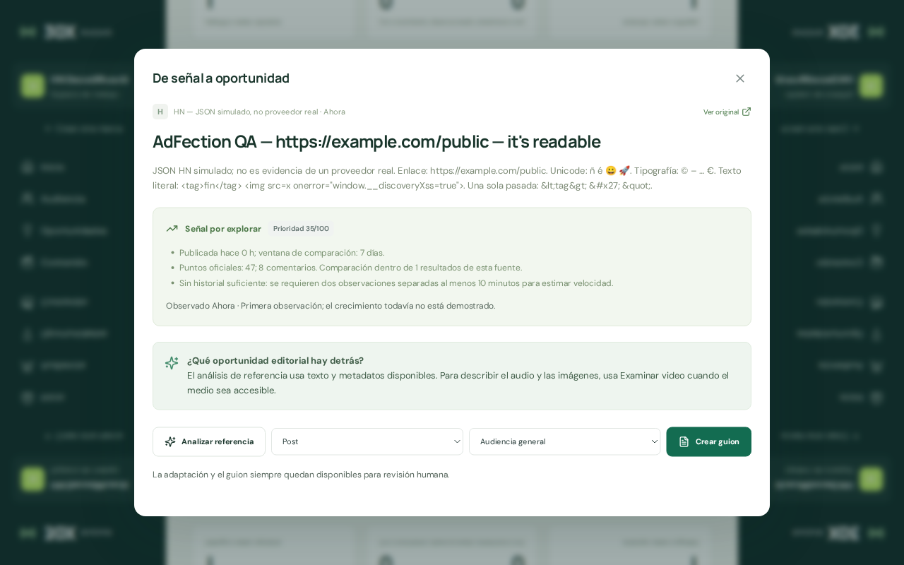
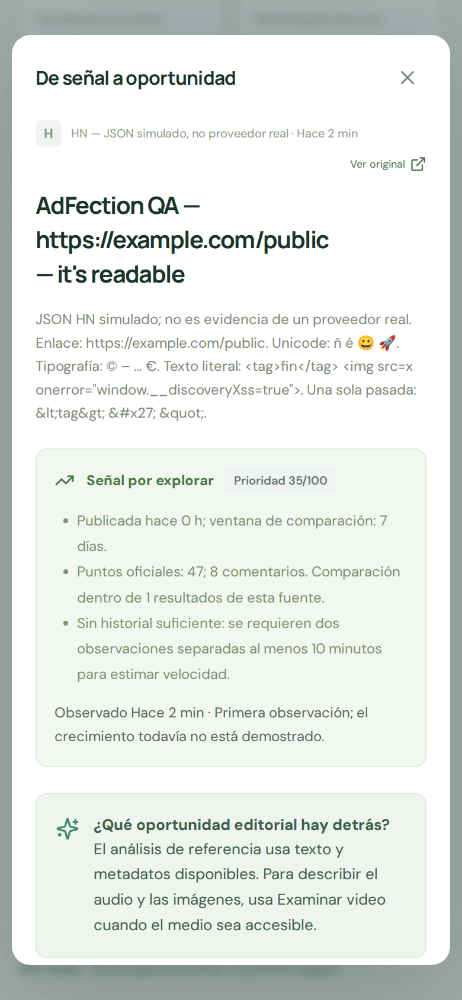

**discovery-2 — Corregido.** Responsable: `fix_discovery_2`.

Los títulos y cuerpos de Hacker News decodifican `&#x2F;`, `&#x27;`, referencias numéricas Unicode y entidades nombradas habituales en una sola pasada. Se conservan como texto los tags codificados; no se convierten en HTML ejecutable. Las entidades desconocidas o incompletas quedan literales y los valores numéricos no válidos producen `�` sin abortar la consulta.

La causa estaba en `clean`: sólo tenía unos pocos reemplazos encadenados. Eso dejaba entidades hexadecimales visibles y podía convertir `&amp;lt;` en `<` mediante dos reemplazos. El arreglo sustituye ese tramo por un decoder de texto de una pasada, manteniendo la eliminación previa del markup real. Incluye las entidades Latin-1 para español/portugués y tipografía común, sin nuevas dependencias.

También se corrigió el refresco conservador de referencias HN históricas. El parser compara el cuerpo persistido con la salida exacta del normalizador anterior aplicada a la respuesta actual del mismo objeto HN y fuente. Sólo si coinciden sustituye el cuerpo por su representación correcta. La metadata de comparación vive en un WeakMap y no se persiste ni se expone por API. Las anotaciones modificadas, el estado, las etiquetas, el análisis y la procedencia se conservan. No hay una migración masiva ni se vuelve a decodificar ciegamente el texto guardado.

**Regresión demostrada**

- Primera ejecución con código original: **2 PASS / 6 FAIL**. La falla principal mostraba `https:&#x2F;&#x2F;...` en lugar de `https://...` desde `fetchSource` y después de `syncSources`.
- Prueba adicional antes de reparar el refresco histórico: **9 PASS / 1 FAIL**. El cuerpo anterior permanecía codificado. Antes de ampliar Latin-1: **10 PASS / 1 FAIL**.
- Suite propia final: **11/11 PASS**, sin fallos, cancelaciones ni skips. Ejercita ambos modos HN mediante JSON controlado, persistencia y deduplicación, Unicode, entidades comunes, doble codificación, valores inválidos, markup literal y ambos caminos del refresco histórico.
- Suites cercanas de intelligence, social intelligence, contexto, análisis de oportunidades y discovery-1: **90/90 PASS**, sin cambiar sus tests.
- Los tests históricos verifican que una reparación cambia el fingerprint de oportunidades porque cambió su evidencia; una anotación preservada o un segundo refresco sin cambios no lo altera. Las piezas aprobadas y su `approvalVersion` permanecen intactas: este arreglo no cambia la política de aprobación editorial.

**Comprobación interactiva**

T3 preview propio en `http://127.0.1.33:5523/radar`, cuenta/empresa ficticias y una referencia importada con **JSON de HN simulado**, sin llamadas a HN. Se abrió `Explorar` desde la tarjeta, se contrastó el detalle, se recargó y se abrió otra vez. En 1280×800 y 390×844:

- Título y detalle muestran `https://`, apóstrofes, `ñ é 😀 🚀` y `© – … €`.
- `<tag>fin</tag>` y `` son texto visible. No aparece una imagen inyectada ni se ejecuta el payload.
- `&amp;lt;` conserva `&lt;` después de una sola pasada; no se decodifica recursivamente.
- Tras recargar, título/cuerpo coinciden exactamente con el estado guardado, mismo ID y métricas sintéticas **47 puntos / 8 comentarios**. No hay desbordamiento horizontal de la página.

Resultados verificables: [suite roja](../evidence/discovery-2-red.tap), [roja histórica](../evidence/discovery-2-legacy-red.tap), [roja Latin-1](../evidence/discovery-2-latin-red.tap), [suite verde](../evidence/discovery-2-green.tap), [suites cercanas](../evidence/discovery-2-nearby.tap), [aserciones UI/API](../evidence/discovery-2/browser-checks.json), [fixture del proveedor](../evidence/discovery-2-browser-seed.mjs) y [salida de ingestión](../evidence/discovery-2-browser-seed.json).

**Límites**

La tabla nombrada incluye XML, Latin-1 y tipografía común; no pretende implementar el catálogo HTML5 completo. Los nombres no soportados permanecen visibles. El refresco histórico preserva cualquier cuerpo distinto del normalizador anterior de la respuesta actual, incluyendo cambios editoriales o cambios de la fuente. Los checks de tags prueban estos payloads en el render React existente; no convierten el decoder en un saneador HTML universal. No se verificó disponibilidad real de HN ni integración de pago y no se ejecutó build global; la integración final corresponde al coordinador.

Se cerró sólo la pestaña propia y se liberaron 4523/5523. DATA_DIR quedó preservado. Durante el SIGTERM deliberado, Node --watch emitió su aserción de cierre FSEventWrap/FSWatcher; ambos listeners quedaron cerrados. [Ciclo de vida](../evidence/discovery-2/lifecycle.json). No se sobrescribió ningún archivo del audit original.
